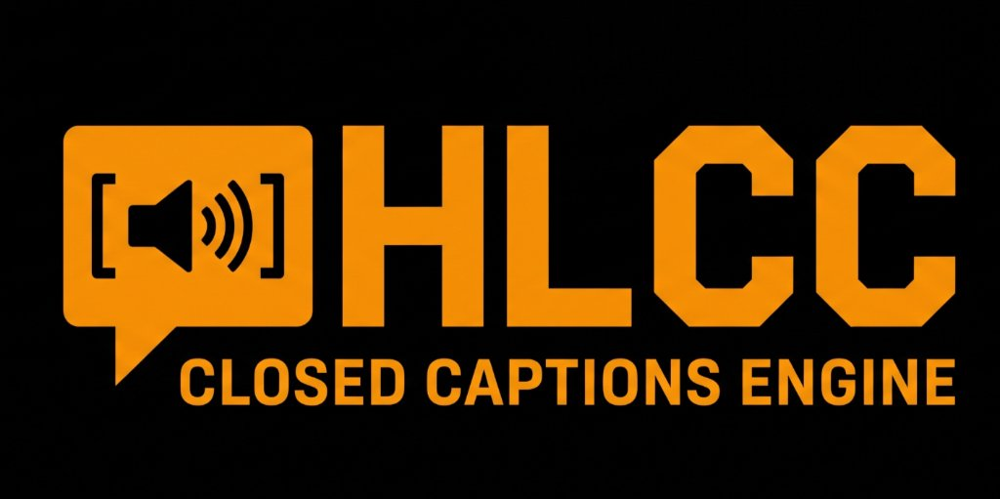
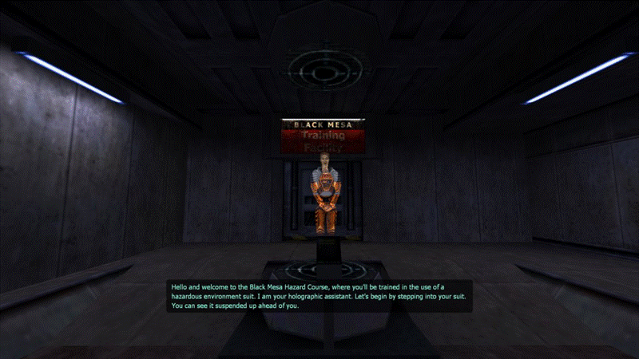

# Half-Life Closed Captions (HLCC)

<p align="center">
  
</p>

<p align="center">
  <a href="#english">English</a> | <a href="#русский">Русский</a>
</p>



| English (`hl2`) | Русский (`hl2`) | Combat / Multi-role (`default`) |
| :---: | :---: | :---: |
|  |  |  |

---

## English

**HLCC** is an external C++23 closed-captions and overlay engine for the Steam GoldSrc trilogy (**Half-Life**, **Opposing Force**, and **Blue Shift**). Because GoldSrc lacks a built-in closed-caption system and modern Unicode overlay pipeline, HLCC attaches cleanly at runtime as a `version.dll` proxy—hooking engine audio (`hw.dll`), client state (`client.dll`), and drawing subtitles directly over the OpenGL frame without modifying original game files. It supports `default` and `hl2` visual presets, **EN / RU / INT** localization (auto-detected EN/RU plus any custom language via `subtitles_*.tsv` patterns in `[Files]`), per-mod `[Mod:*]` profiles, and optional extras such as FBO HUD scaling and a projected 3D OpenGL flashlight.

### Installation
1. Download `HLCC-win32.zip` from **Releases** and extract it next to `hl.exe`.
2. Launch the game in **OpenGL** video mode.
3. **Linux / Steam Deck:** enable **Proton** in Steam compatibility properties and add to Launch Options:
   ```text
   WINEDLLOVERRIDES="version=n,b" %command%
   ```

### Quick `subtitles.ini` Reference
Changes hot-reload in-game within ~1 second (or run `subtitles_reload` in the console; also available: `subtitles_clear`, `hev_voice`).

| Section / Key | Description |
| :--- | :--- |
| `[Visual]` `style` / `font_size` | `default` (dynamic rounded plate) or `hl2` (scrolling box); `0` = auto size |
| `[Filtering]` `min_volume` / `use_attenuation_cutoff` / `check_occlusion` | Perceived-volume threshold (`SND_Spatialize`) and line-of-sight wall/glass attenuation |
| `[Filtering]` `restore_unused_hev` / `auto_wav_timing` | Restores unused HEV suit cues; optional `.wav` duration probing (`1`) |
| `[HUD]` `hud_scale` / `hud_compact_armor` / `enable_gl_flashlight` | Offscreen FBO HUD scaling, compact armor spacing, and 3D OpenGL flashlight |
| `[Mod:<gameDir>]` | Per-mod overrides (e.g. `[Mod:bshift]`, `[Mod:gearbox]`, `[Mod:hl1mmod]`) |
| `[Files]` `language` / `subtitles_pattern` / `titles_pattern` | `auto`, `ru`, `en`, or custom **INT** TSV filename patterns (`subtitles_de.tsv`) |

Architecture, building from source (`LLVM-MinGW`), mod adaptation, and translation rules: **[MODDER_GUIDE.md](MODDER_GUIDE.md)**.

---

## Русский

**HLCC** — внешний движок субтитров и оверлея на C++23 для Steam-трилогии на GoldSrc (**Half-Life**, **Opposing Force** и **Blue Shift**). Поскольку в самом GoldSrc нет встроенной системы субтитров и нормального рендера юникода поверх кадра, HLCC подключается на лету как прокси `version.dll`: перехватывает звук (`hw.dll`) и клиент (`client.dll`), не меняя оригинальные файлы игры, и выводит субтитры прямо в OpenGL-кадр. Поддерживаются пресеты `default` и `hl2`, локализация **RU / EN / INT** (автоопределение русского и английского + подключение любого другого перевода через паттерны `subtitles_*.tsv` в `[Files]`), профили модов `[Mod:*]`, а также опциональные FBO-масштабирование HUD и 3D OpenGL-фонарик.

### Установка
1. Скачайте `HLCC-win32.zip` из **Releases** и распакуйте в корневую папку с `hl.exe`.
2. Запускайте игру в режиме **OpenGL**.
3. **Linux / Steam Deck:** включите **Proton** в свойствах совместимости Steam и добавьте в параметры запуска:
   ```text
   WINEDLLOVERRIDES="version=n,b" %command%
   ```

### Краткая справка по `subtitles.ini`
Настройки подхватываются в игре автоматически за ~1 секунду (либо командой `subtitles_reload` в консоли; также доступны `subtitles_clear` и `hev_voice`).

| Секция / Ключ | Назначение |
| :--- | :--- |
| `[Visual]` `style` / `font_size` | Пресет `default` (динамическая плашка) или `hl2` (окно со скроллом); `0` = авторазмер |
| `[Filtering]` `min_volume` / `use_attenuation_cutoff` / `check_occlusion` | Порог слышимой громкости (`SND_Spatialize`) и учёт стен/стекла |
| `[Filtering]` `restore_unused_hev` / `auto_wav_timing` | Восстановление неиспользуемых фраз HEV; замер длительности по `.wav` (`1`) |
| `[HUD]` `hud_scale` / `hud_compact_armor` / `enable_gl_flashlight` | Масштаб HUD через FBO, компактная броня и 3D OpenGL-фонарик |
| `[Mod:<gameDir>]` | Переопределения под конкретный мод (`[Mod:bshift]`, `[Mod:gearbox]`, `[Mod:hl1mmod]`) |
| `[Files]` `language` / `subtitles_pattern` / `titles_pattern` | `auto`, `ru`, `en` или свой **INT**-перевод (`subtitles_de.tsv`, `titles_de.tsv`) |

Архитектура (`core` / `render` / `goldsrc` / `proxy`), сборка из исходников (`LLVM-MinGW`) и руководство для моддеров: **[MODDER_GUIDE.md](MODDER_GUIDE.md)**.
