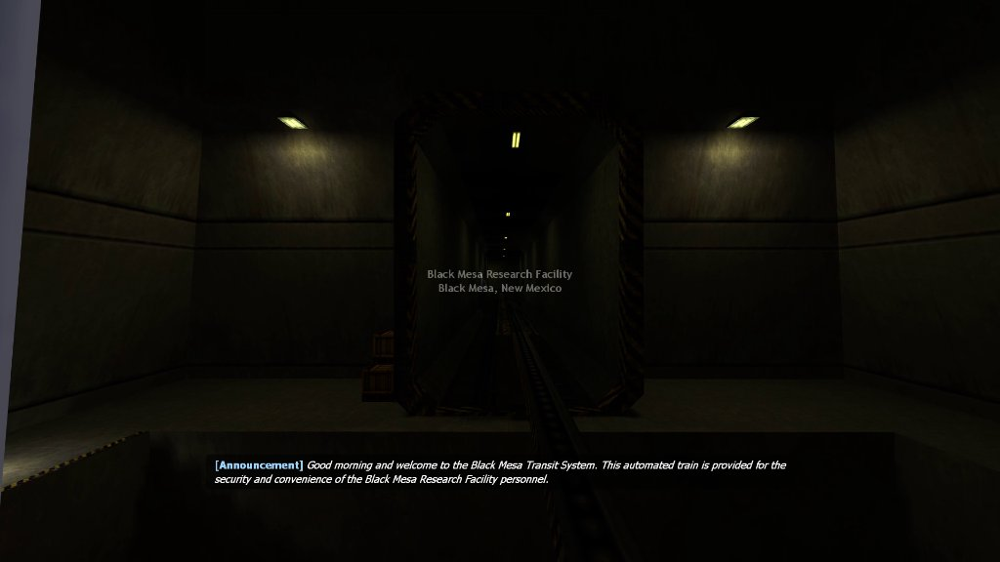
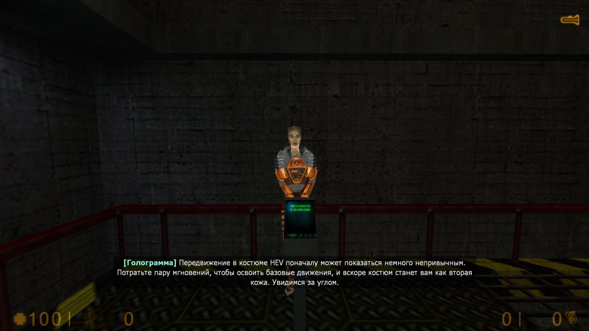
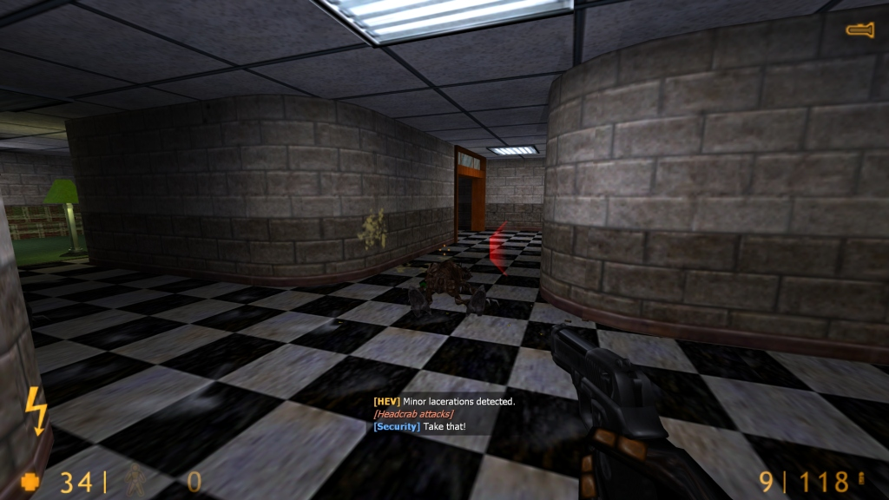

# HLCC — Half-Life Closed Captions (C++23)

[English](#english) | [Русский](#русский)

---

## English

A proxy plugin mod subtitles (`version.dll`) for the **Half-Life**, **Opposing Force**, and **Blue Shift** Steam trilogy without modifying original game files:

- **HL2-Style Closed Captions:** NPC dialogue, radio, VOX, suit (HEV/PCV), and key gameplay SFX with anti-spam protection.
- **Distance & Occlusion Filtering:** filters out sounds behind solid walls while handling glass and scripted scenes properly.
- **Two OpenGL Render Styles:** dynamic plate (`default`) or fixed-width box with smooth vertical scrolling (`hl2`).
- **Auto-Localization (EN/RU):** automatic language selection from Steam settings, chapter/title translation, and optional `.wav` auto-timing for third-party voiceovers.
- **HUD & Graphics Enhancements:** FBO HUD scaling and compact armor layout for the expansions (`bshift`, `gearbox`), plus a 3D projected OpenGL flashlight.

### Preview


| English (`default`) | Русский (`default`) | Combat / Multi-role |
| :---: | :---: | :---: |
|  |  |  |

### Installation
1. Download `HLCC-win32.zip` from the **Releases** page.
2. Extract its contents into the **Half-Life** root directory (next to `hl.exe`), overwriting if prompted.
3. Launch the game in **OpenGL** mode.
4. **For Linux / Steam Deck (Steam Proton):** enable **Proton** in the game's Steam Compatibility properties (the native Linux `hl_linux` binary does not load `version.dll`) and add to Launch Options:
   ```text
   WINEDLLOVERRIDES="version=n,b" %command%
   ```
5. Optionally customize the font, preset, colors, `[Mod:*]` profiles, and filters in `subtitles.ini`.

### Documentation & Structure
- [MODDER_GUIDE.md](MODDER_GUIDE.md) — `version.dll` architecture, adapting HLCC to third-party GoldSrc mods, and subtitle translation guide
- `src/` — `version.dll` C++23 source code and `build.bat`
- `valve/`, `gearbox/`, `bshift/` — subtitle (`subtitles_ru.tsv`, `subtitles_en.tsv`) and title (`titles_ru.tsv`) databases
- `subtitles.ini` — default configuration (including `[Mod:bshift]`, `[Mod:gearbox]`, `[Mod:hl1mmod]` profiles)
- `package_release.ps1` — packages `release/HLCC-win32.zip`

### Building from Source
Requires **LLVM-MinGW (UCRT)** (`winget install MartinStorsjo.LLVM-MinGW.UCRT`) targeting `i686-w64-mingw32`:

```bat
cd src
build.bat
```

To package the release archive:

```powershell
powershell -ExecutionPolicy Bypass -File package_release.ps1
```

`.github/workflows/build.yml` automatically builds `version.dll` via GitHub Actions and publishes a **GitHub Release** with `HLCC-win32.zip` when a `v*` tag is pushed.

---

## Русский

Мод-плагин субтитров (`version.dll`) для Steam-трилогии **Half-Life**, **Opposing Force** и **Blue Shift** без изменения файлов игры:

- **Субтитры в стиле HL2:** речь NPC, радио, VOX, костюм (HEV/PCV) и важные игровые SFX с защитой от спама.
- **Учёт дистанции и преград:** фильтрация звуков за глухими стенами, корректная работа через стекло и в скриптовых сценах.
- **Два стиля рендера (OpenGL):** динамическая плашка (`default`) или фиксированное окно с плавным скроллом (`hl2`).
- **Автолокализация (EN/RU):** переключение языка по настройкам Steam, перевод заголовков глав и автотайминги по `.wav` для сторонних озвучек.
- **Улучшения графики и HUD:** масштабирование старого HUD и фикс ванильного HUD в дополнениях (`bshift`, `gearbox`), плюс 3D OpenGL-фонарик.

### Скриншоты


| English (`default`) | Русский (`default`) | Бой / несколько ролей |
| :---: | :---: | :---: |
|  |  |  |

### Установка
1. Скачайте архив `HLCC-win32.zip` со страницы **Releases**.
2. Распакуйте содержимое в корневую папку **Half-Life** (рядом с `hl.exe`) с заменой файлов.
3. Запускайте игру в режиме **OpenGL**.
4. **Для Linux / Steam Deck (Steam Proton):** в свойствах игры включите **Proton** (нативный Linux-билд `hl_linux` не загружает `version.dll`) и добавьте в параметры запуска:
   ```text
   WINEDLLOVERRIDES="version=n,b" %command%
   ```
5. При необходимости настройте шрифт, пресет, цвета, профили `[Mod:*]` и фильтры в `subtitles.ini`.

### Документация и структура
- [MODDER_GUIDE.md](MODDER_GUIDE.md) — архитектура `version.dll`, адаптация под сторонние GoldSrc-моды и руководство по переводу субтитров на другие языки (EN)
- `src/` — исходный код `version.dll` (C++23) и скрипт сборки `build.bat`
- `valve/`, `gearbox/`, `bshift/` — базы субтитров (`subtitles_ru.tsv`, `subtitles_en.tsv`) и заголовков (`titles_ru.tsv`)
- `subtitles.ini` — конфигурация по умолчанию (включая профили `[Mod:bshift]`, `[Mod:gearbox]`, `[Mod:hl1mmod]`)
- `package_release.ps1` — скрипт сборки архива `release/HLCC-win32.zip`

### Сборка из исходников
Требуется **LLVM-MinGW (UCRT)** (`winget install MartinStorsjo.LLVM-MinGW.UCRT`) с таргетом `i686-w64-mingw32`:

```bat
cd src
build.bat
```

Для упаковки релизного архива:

```powershell
powershell -ExecutionPolicy Bypass -File package_release.ps1
```

В `.github/workflows/build.yml` также настроена автоматическая сборка в GitHub Actions и публикация **GitHub Release** с `HLCC-win32.zip` при пуше тега `v*`.
